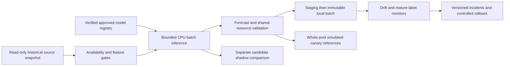

# Season 23: production-oriented local batch serving

This is a **LOCAL HISTORICAL DEMONSTRATION**. Actual M5 recorded sales feed
forecasts. Inventory, procurement costs, supplier limits, approvals, canaries,
fallback incidents and controller outcomes are **SIMULATED / ASSUMED**. There
is no Walmart connection, real order dispatcher, live monitoring or measured
business policy effect. Season 22 causal outcomes are not serving observations.

## Lifecycle and boundaries

`demandos.serving` separates canonical identities/local atomic operations,
feature contracts, immutable registry manifests, native prediction adapters,
batch publication, monitoring, incidents/failure drills, whole-pool routing,
simulated decision validation, independent audit, reports and CLI orchestration.
It reuses Seasons 8/16 feature code, the saved native quantile loader and
Seasons 18-21 inventory/optimization engines. Earlier CLIs/defaults are preserved.



The driver uses the established 25-series cohort, origins January 31, February
28 and March 27, 2016, and horizons 1-28. It reads only a bounded daily snapshot
through DuckDB. It never materializes the full 58-million-row panel.

## Registry, eligibility and artifact security

Three explicit entries are supported:

- `s16-lgb-20160131`: existing Season 16 P10/P50/P90 native LightGBM ensemble,
  fit through January 31, 2016; December 6-January 3 development validation.
- `s17-precalibration-lgb-20151011`: actual older Season 17 frozen tree
  ensemble, fit through October 11, 2015; September 13-October 11 validation.
  It is a separately identified candidate, **before conformal correction**.
  Its differing fit window is disclosed; it is not called an improved successor.
- `historical-56d-v1`: the existing trailing 56-day empirical inverse-CDF
  quantile algorithm, including zeros. Its JSON recipe explicitly declares
  **no trained weights**. It is not a fabricated historically trained model.

Immutable JSON entries contain model/version, exact artifact paths and SHA-256
digests, ensemble digest, fit cutoff, validation window, feature contract hash,
supported horizons, output schema, dependencies, initial candidate status and
approval/rollback lineage reference. Current candidate/approved/retired status
is derived from hash-linked events in an atomically replaced state file.
Each role (`forecast`, `fallback`, `canary`) has one unambiguous alias.

Only explicitly trusted repository-local native TXT/JSON artifacts are loaded.
Every component is hashed before the existing loader runs; native LightGBM
version must match historical metadata, and recorded runtime dependencies must
match. Path traversal/symlink escape and unknown formats fail. Fit cutoffs must
not exceed issuance origins. Retired models cannot serve, and an active alias
cannot be retired. These are educational local approvals based on hard gates;
future evaluation errors do not approve historical origin decisions.

A hash checks identity relative to trusted metadata, not model correctness or
protection against an attacker rewriting the entire trusted workspace. We use
no pickle/joblib loading. Their code-execution and environment-compatibility
risks are described in the [official scikit-learn persistence documentation](https://scikit-learn.org/stable/model_persistence.html).

## Versioned features and point-in-time availability

The contract saves the existing 80 field definitions, units, types, null rules,
57 native predictors, transformation-source hashes, history requirement,
category mapping/vocabularies, supported horizons and output schema.
`features.validation.generate` and `GlobalModel.matrix` are reused rather than
rewriting training transforms. Native categories use each checkpoint's own
saved vocabulary; mapping code 0 retains its original unknown meaning.

History requires 57 complete calendar days, including the origin and lag 56.
The end-of-day origin includes that day's recorded sales. The existing seven-day
mean is origin-inclusive; origin lag 1 uses E-1, never target-relative sales.
The simple golden past-seven-day mean of [10,12,8,14,11,9,13] is 11; incorrectly
including 40 gives 107/7. Full generated snapshots are compared with saved
Season 16 inference references and their resulting repaired forecasts.

M5 has no actual ingestion timestamps. `available_at=event_date` at day end is
an **explicit assumed replay rule**. Both event date and availability date must
be <=E. A synthetic delayed origin observation is excluded, then freshness /
complete-history gates block issuance. Missing critical sales are not zero-filled.
Synthetic availability metadata is not claimed to be a Walmart observation.
Calendar variables retain the earlier assumed known-future contract. Selling
prices remain unavailable without separately verified historical knowledge
stamps; evaluation prices never become origin features.

Tests inject lag-offset, missing-value and category-encoding mismatches.
Real replay mutates/deletes post-E sales and changes future prices; eligible
snapshot identity, features, forecasts and complete pool allocation vectors
must remain unchanged. Controller tests separately check all-series prefix
states/decisions before future demand or delivery changes, fresh resets and
hidden lost-demand isolation.

## Batch identity, publication and lineage

Canonical batch identity hashes model digest/version, feature contract digest,
eligible source snapshot digest, origin/cohort/horizons, relevant configuration,
dependency/code versions, resource limits, channel and fallback/incident context.
The snapshot hash excludes unavailable/future observations; full raw-source
fingerprints are separately retained for integrity.

Prediction grain is `(model_version, origin, store_id, item_id, horizon,
target_date)`. Each supported series-origin has exactly 28 rows. Numeric finite
outputs must obey 0<=Q10<=Q50<=Q90 and exact date alignment. Raw endpoints remain
available; existing nonnegative monotone repair is explicit and checked. The
point forecast is repaired Q50. Replay tolerance is absolute 1e-10 within the
recorded local CPU environment, not a claim of universal bitwise portability.

Writers use local exclusive lock files, short Windows-compatible staging names,
persisted-byte validation, file/content manifests and same-volume atomic
directory rename. A completed batch is immutable. Identical retry reuses it;
matching ID/different content or corrupted files hard fail. Injected interruption
leaves an unpublished diagnostic staging directory; retry creates one completed
batch. Process-death stale locks conservatively block until an operator checks
the owner; the demo does not automatically delete another writer's lock.
This is effectively-once **local publication**, not distributed exactly-once
processing or power-loss/external-order delivery guarantees.

Forecasts/decisions link batch ID, model/version/digest, source snapshot, contract,
prediction IDs/dates/values, optimizer/policy version, resource digest/limits,
approved quantity, validation, fallback and incident IDs. Publication manifests
bind complete content. Canary actions reference original forecasts rather than
duplicating forecast rows. They have separate deterministic action IDs and a
separate simulation namespace; no extra orders are applied to approved replay
inventory. Shadow comparison batches publish zero active actions.

## Drift and delayed performance

Fixed-reference PSI is `sum((q-p)*log(q/p))`. Reference-defined numerical bins
include infinite endpoints and a separate missing bucket; zero probabilities
are floored at epsilon=1e-6 and renormalized before scoring. Golden [.5,.5]
versus [.3,.7] gives 0.169459572. Equal distributions give zero.

Descriptive two-sample KS is `sup_x abs(F_reference(x)-F_current(x))`, including
ties; [1,2,3,4] versus [3,4,5,6] gives .5. Finite values are used for KS;
missing counts are explicit, and an empty finite sample is unavailable.
There are no calibrated IID p-value claims for dependent sales/horizon data.

January 31 freezes the reference. History metrics use 25 distinct series;
prediction/width metrics use 700 correlated rows. The versioned heuristic
policy requires at least 20 finite samples, PSI>.25 or KS>.30 for descriptive
drift warnings, and missingness increase>.10 independently. Bins, sample sizes,
raw values/frequencies, epsilon, window and threshold version are recorded.
Injected mean increase, zero inflation, extreme spike and missingness exercise
warnings; malformed categories/schema and critical history loss block instead.
Thresholds are predeclared, not tuned after evaluation. No universal PSI cutoff
or automatic causal failure claim is made. The [official BigQuery monitoring
overview](https://docs.cloud.google.com/bigquery/docs/model-monitoring-overview)
provides background on comparing model-input distributions; no Google service
is connected by this project.

For an assumed label lag delta, a label matures only if target_date+delta is
<=monitoring cutoff and an actual label exists. With E=2016-01-31, cutoff
2016-02-10 and lag2, only horizons1-8 mature (200/700 cohort rows). Horizons9-28
remain unavailable. Missing labels are never changed to zero. Configurable
scoring reports MAE, WAPE/observed-unit denominator, mean pinball, inclusive
P10-P90 coverage and width, with origin/cohort breakdowns. Zero WAPE denominator
is unavailable. Candidate/reference comparisons use identical mature keys.
Coverage is an empirical retrospective diagnostic, not guaranteed calibration.

## Decisions, incidents, shadow, canary and rollback

Origin authorization uses `ceil(sum(Q50 for days1-14))` as a **point-target
heuristic**, then reuses the mean-mismatch allocator under shared hard limits.
It does not sum marginal quantiles and call that a calibrated lead-time quantile.
Limits are frozen from prior56-day means; initial stock10/pipeline3, purchase60,
order fee5, holding.2 and lost-unit penalty40 are assumed. Case pack1/MOQ0 retain
earlier defaults, with nontrivial violations exercised in tests.

The full-controller outcome ledger is a separate matched simulation using the
same forecast target rule and original post-demand review timeline. Its day1
decision can differ from the static origin authorization as observable stock
changes. Its operating costs are not falsely assigned to the static preview
vector. Both models receive identical reset states/exogenous worlds. Independent
checks cover cash/supplier commitments, packs/MOQ/flow/store quotas, physical
stock/backlog/queue conservation, event identities, receipts, costs and fill.
Four distinct eligible-history evaluation worlds per origin are separate from
planning samples; CVaR(.75) is the worst of four, a weak conditional diagnostic.
All item histories and economic/supplier parameters remain assumed scenarios.

Hard failures include artifact/schema/availability/history/key/finite-output
or resource-feasibility violations. Warning policy separately covers descriptive
drift, mature MAE deterioration>.20, coverage drop>.10, injected fallback
rate>.10, and delayed simulated cost increase>.10 / fill drop>.05. Event IDs,
as-of times, versions, signals/thresholds, evidence, disposition and publication
links are retained. Synthetic rates are not live reliability measurements.

Both native models run shadow comparisons on matched snapshots, with output
coverage/runtime, mature metrics and feasible comparison plans. Canary routing
hashes the whole shared-resource pool with fixed seed42/fraction.5, stable
across origins. One actual pool and three dependent episodes cannot support a
real A/B-effect claim. Candidate approval requires hard gates; delayed outcomes
do not select origin forecasts/routes. Local canary actions are reversible
simulated exposures, not a rollout to a business system.

Rollback verifies prior approved artifacts/contract before atomically replacing
an alias, retaining manifests, history and completed batches. Missing/tampered
targets leave the alias unchanged. An eligible historical baseline can recover
from a model failure only after input/temporal/output/resource gates. Stale
source, missing critical history, infeasibility or incompatible fallback lead to
blocked publication/human review. Last-good stale forecasts are not silently
reused; zero ordering is not claimed universally safe.

## Reproduction and generated artifacts

```powershell
.\.venv\Scripts\python -m demandos.serving --root . --config configs/serving.toml
.\.venv\Scripts\python -m unittest discover -s tests -v
.\.venv\Scripts\python -c "from pathlib import Path; from demandos.warehouse.cli import settings,invoke_dbt; root,source,output,env=settings(Path.cwd()); invoke_dbt(root,env,'test')"
```

Use the established analytics/boosting/reconciliation environment and existing
Season16/17 artifacts. The runner does not download/retrain missing checkpoints;
it reports a genuine missing-essential-artifact blocker. No dependency or cloud
service is added. Close the serving warehouse connection before real dbt tests.

Ignored `data/serving/m5_h28/latest_verified.json` points to a successful
versioned run after independent audits and unchanged source/model/warehouse
checks. The run contains `registry/`, `feature_contract.json`, immutable
`publication/batches/`, `canary/` decision references, Parquet feature/forecast/
maturity/monitor/decision tables, full `simulation/` ledgers, incident/retry/
fault audits, provenance and `serving_report.md`. Failed/unverified runs do not
receive a verified pointer. Code/contract changes create another run namespace;
completed batches are preserved. Random seeds do not guarantee identical
time-limited MILP incumbents across hardware; actual vectors/status/gaps remain
auditable. Source data and earlier models remain untouched.

## Verified historical replay findings

The final code-bound run is `4a1ac097e68396db82c0`. Actual input is the established
25 M5 series (13 continuity / 12 sparse-stress), three retrospective origins,
75 observed-sales paths and 2,100 daily targets. The warehouse remains
58,327,370 rows / 30,490 series. There are no live feeds or actual inventory logs.

Both native models served all 25 x 3 x 28 cases: **2,100 rows each**. The
fallback drill served 700 first-origin rows, yielding **4,900 unique forecast
rows in seven immutable batches**. Approved-reference batches authorize 75
simulated origin rows; one fallback batch authorizes 25. Shadow publishes zero
actions. Seven identical-request retries reuse existing completed batches;
the separate-process replay check is retained with final validation artifacts.

| Model | Mature rows | MAE | WAPE | Mean pinball | Inclusive P10-P90 coverage | Mean width |
|---|---:|---:|---:|---:|---:|---:|
| S16 approved reference | 2100 | 9.393891 | 60.4349% | 2.858507 | 79.7143% | 20.003544 |
| S17 older pre-calibration candidate | 2100 | 8.414804 | 54.1360% | 2.685633 | 77.6190% | 19.837356 |
| Historical fallback, January only | 700 | 11.252857 | 72.2727% | 3.327571 | 83.1429% | 21.520000 |

The two native models use identical evaluation cases with 32,642 observed
units; the fallback uses only the first origin / 10,899 units and is not
compared as though it had the same origin mix. Each early monitoring slice
has exactly 200 mature and 500 unavailable rows; each complete slice has 700
mature rows. All 42 origin/cohort/window metric records are independently
recalculated. The injected missing-label drill retains one unavailable label.

January reference-vs-itself PSI/KS is zero. March descriptive examples:

| Signal | Sample rows per side | PSI | KS |
|---|---:|---:|---:|
| Seven-day mean | 25 | 0.458883 | 0.120000 |
| 28-day zero fraction | 25 | 3.575416 | 0.240000 |
| Predicted Q50 | 700 | 1.445737 | 0.120000 |
| Interval width | 700 | 1.318274 | 0.105714 |

There are eight descriptive warnings across the 15 actual-input drift records.
These are sensitive small-sample, fixed-bin diagnostics, not significance tests.
The four predeclared synthetic shifts all warned:

| Injected shift | PSI | KS |
|---|---:|---:|
| Mean increase | 6.144309 | 0.560000 |
| Zero inflation | 10.971094 | 0.800000 |
| Extreme origin spike | 14.291898 | 1.000000 |
| Feature missingness | 7.502384 | 0.200000 |

The matched simulator executed **30 complete pool runs / 21,000 daily rows**,
plus 24 reset/future/hidden-demand replay interventions. All 120 controller
decision solves were optimal, maximum MIP gap zero. Original source/model
files were rehashed after execution and remained unchanged.

| Model | World distribution | Pool runs | Mean assumed operating cost | Aggregate immediate fill | Lost units/run |
|---|---|---:|---:|---:|---:|
| S16 | Three observed-sales proxy paths | 3 | 592656.67 | 47.0682% | 5759.33 |
| S17 | Same observed-sales proxy paths | 3 | 639401.40 | 54.4544% | 4955.67 |
| S16 | Four bootstrap worlds per origin | 12 | 547853.08 | 51.4853% | 4665.25 |
| S17 | Same bootstrap worlds | 12 | 596101.53 | 59.4728% | 3897.17 |

Average origin-specific operating CVaR(.75) was **560885.53** for S16 and
**610906.93** for S17. These small conditional simulator tails are not real
Walmart risk estimates. Better candidate MAE did not imply lower operating
cost; service and cost moved together under the assumed policy/economics.

The fixed canary hash was **0.409383**, below fraction .5, so the entire pool
routed to the locally approved candidate at all three origins: **75 simulated
canary rows**, with no duplicate forecast publication and no extra orders
applied to approved replay state. These are three dependent episodes of one
actual pool. Rollback restored S16 and preserved every completed batch byte.

All **28 fault cases** met their declared disposition: 24 blocking rejections,
three recoveries (trusted baseline, interrupted-write retry, prior approved
alias), and one missing-label warning. The incident ledger contains **24
blocking / 21 warning / 4 informational** records, all labeled as historical
monitoring or synthetic exercises. The injected baseline fallback rate is
1/7=14.29%; it is not a live operational reliability statistic.

The **30 independent audit gates** cover persisted schemas/keys, source-feature
goldens, forecast goldens, all 19 PSI/KS records, all 42 forecast metric records,
actual labels, common worlds, physical/queue/event/cash/supplier/resource
invariants, mature-label rules, canary/rollback and idempotency. Six saved-feature
parity comparisons, 18 real future-data forecast/vector checks and 24 controller
temporal checks pass. The measured execution took **112.35 seconds**, peak
process memory **624.38 MiB**, in the recorded CPU environment.
All **392 Python tests** (28 new serving tests) and **36 fresh real-data dbt
tests** pass without skips. Final validation records bind test evidence,
code/config/document hashes and the independently replayed completed batches.
