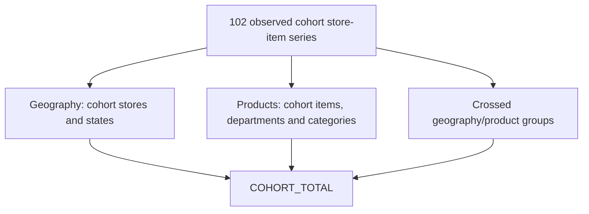

# Season 15: grouped M5 point-forecast reconciliation

`demandos.reconciliation` implements sparse grouping and bounded chronological
point reconciliation. Full M5 membership is verified; forecasting experiments
use an explicitly named **cohort-induced** hierarchy. The warehouse, ingestion
pipeline and earlier model implementations are preserved.

## Groupings and matrix contracts

Nested store/state and item/department/category relationships coexist with
crossed geography/product groupings. They do not form one ordinary tree.
For a bottom vector `b`, `y_all = S @ b`. A bottom belongs to exactly one node
within each level, so summing one whole level recovers the total. Summing all
12 levels counts the same observed units 12 times.

| Level | Dimensions | Full nodes | Cohort nodes |
|---|---|---:|---:|
| TOTAL | none | 1 | 1 |
| STATE | state | 3 | 3 |
| STORE | store | 10 | 10 |
| CATEGORY | category | 3 | 3 |
| DEPARTMENT | department | 7 | 7 |
| STATE_CATEGORY | state, category | 9 | 9 |
| STATE_DEPARTMENT | state, department | 21 | 20 |
| STORE_CATEGORY | store, category | 30 | 27 |
| STORE_DEPARTMENT | store, department | 70 | 45 |
| ITEM | item | 3,049 | 82 |
| ITEM_STATE | item, state | 9,147 | 89 |
| ITEM_STORE | store, item | 30,490 | 102 |
| **All levels** | | **42,840** | **398** |

Full `S` is CSR float64, shape **42,840 × 30,490**, with **365,880** ones and
**4,561,924 bytes** across data/indices/indptr. Cohort `S` is **398 × 102**,
with **1,224** ones and **16,284 bytes**. Full matrices are never densified;
dense solvers reject more than the configured 128 bottom series before
conversion, with a hard configurable ceiling of 256.

Bottom columns sort by `(store_id,item_id)`. Levels follow the table order;
nodes within each level sort lexicographically by dimension tuple. Node IDs
combine `FULL_` or `COHORT_`, the level and a canonical compact JSON tuple.
The final ITEM_STORE block is an identity matrix in bottom-column order.
Parquet node, bottom and membership maps accompany each saved sparse matrix.
Store-to-state, item-to-department/category and department-to-category mappings
must be consistent and complete. Duplicate bottom keys, empty groups, fanout,
missing daily records and invalid sales are hard failures.

Independent DuckDB grouping checks cover **every node at every level** on
2011-01-29, 2016-02-29 and 2016-04-24, for both scopes. All gaps are zero.
The complete cohort observed history is also grouped directly in DuckDB and
compared with `S @ bottom_actuals`: **761,374 node-day rows** agree exactly.



The paths describe alternative aggregations of the same universe; their totals
must not be added together.

## Cohort and independent forecast provenance

The cohort is the union of the existing 96 deterministic training series and
the exact 13 continuity series, with seven overlapping: **102 unique bottoms**.
The 96-series rule uses prefix labels through **2014-01-04**, per-store coverage
and a seeded stable selection in the existing boosting selector. The original
13 series were selected through **2016-01-31**. Both selection cutoffs precede
the first evaluation target; they are recorded separately. The latter is a
continuity sample, not an independently selected historical calibration sample.
Its inclusion conditions the residual panel on this fixed benchmark universe.
No evaluation-period outcomes select additional series or tune settings.

For each evaluation origin, the existing interpretable N-BEATS native checkpoint
is loaded from `data/nbeats/global_h28/models/interpretable/origin_YYYYMMDD/`.
Fitting and fitting-label maxima must precede or equal the issue origin.
Inference runs on all 102 series, using only each series' last 56 observed days,
history mask and own-origin mean scale. The original 13 predictions are checked
against native inference, then their serialized values are preserved exactly.
The other 89 series receive genuine additional checkpoint inference. All 102
use the same architecture; no hidden statistical fallback is mixed into bottoms.

The base table records **1,092 verified prior predictions**, **7,476 additional
native bottom predictions** and **24,864 independent aggregate predictions**.
For each non-bottom node, seasonal naive with period seven forecasts its actual
observed aggregate history directly. These are not sums of N-BEATS predictions.
Although seasonal naive commutes with aggregation of actual histories, its
aggregate predictions disagree with the independently learned N-BEATS bottoms.
The observed maximum initial constraint gap is **539.320287 units**.

Each base records node, origin, target date, horizon, source model, prediction
source, fitting cutoff, fitting-target maximum and observed-history cutoff.
Source/model/config hashes and exact prior target/scale agreements are checked.

## Methods and stable numerical solution

The usual notation is `y_tilde = S G y_hat`, where `G` maps independent all-node
base forecasts to bottom estimates. The implementation solves for these bottom
estimates directly, without explicitly materializing an inverse or a full `G`.

- **Bottom-up:** preserve N-BEATS bottoms and multiply by sparse `S`.
- **Top-down:** allocate the independently forecast COHORT_TOTAL using trailing
  365-day observed-sales volume shares, ending at the issue origin; then use `S`.
- **Middle-out:** independently forecast COHORT_STORE_DEPARTMENT nodes and allocate
  within each group with the same prefix-volume rule. This level is a disjoint,
  nonempty partition of the selected bottom universe. All crossed levels are
  subsequently derived from bottom estimates through `S`.
- **OLS:** minimize `||S b - y_hat||²`. Bounded QR solves the least-squares problem.
  For `S=[[1,1],[1,0],[0,1]]` and `[350,100,200]`, the result is
  `[333.333333333,116.666666667,216.666666667]`.
- **Structural WLS:** diagonal variance equals the number of descendant bottom
  members in each row. This follows from an approximation of independent,
  equal-variance bottom errors; it is an assumption about error scale, not an
  assertion that the actual independent aggregate models have this covariance.
- **Variance WLS:** diagonal sample variances of aligned historical OOS errors,
  with a positive median-relative floor for zero-variance nodes.
- **Shrinkage MinT-style:** use the paired empirical covariance, fixed 90%
  shrinkage to its floored diagonal, and a ridge of `1e-6 * mean(diagonal)`.
  This is a controlled approximation, not a claim of optimal shrinkage. Support,
  rank and conditioning gates can explicitly replace it with diagonal or
  structural WLS. The real experiment below requires this fallback.
- **Nonnegative WLS:** bounded SciPy NNLS solves the whitened weighted problem
  subject to `b >= 0`; aggregates are always `S @ b`. It uses the accepted
  covariance or its explicitly recorded fallback.

For diagonal `W`, rows are divided by square-root variances. For a full SPD `W`,
Cholesky and triangular solves whiten `S` and `y_hat`. QR solves the whitened
problem; no covariance or normal-equation inverse is formed. The solver checks
finite inputs, shape alignment, design rank and condition number (ceiling
`1e12`). NNLS uses its default numerical tolerances and a `10 * n_bottom`
iteration cap; failure is a hard error, not independent clipping. Post-solve
coherence must hold within `1e-8`; reported negative counts use `-1e-10`.

Shares are nonnegative and sum to one within each partition group. Supported
all-zero groups use an explicit uniform fallback. Unsupported/new descendants
get zero share and a recorded support count; a group with no supported members
is unavailable and stops this complete-case experiment. Empty groups and missing
supported source histories fail rather than being fabricated as zeros. The
actual complete-history cohort required no allocation fallback or skip.

## Historical residuals and temporal isolation

Historical errors come from **14 genuine N-BEATS refits**, issued every 28 days
from **2014-12-07 to 2015-12-06**. Each fit uses the established 96 training
series, fixed architecture/optimizer/seed and a predeclared **two-epoch budget**;
all complete 28-label training vectors end by its own issue origin. No later
checkpoint is used to predict earlier origins, and no later validation outcomes
select a historical fit's epoch. Aggregate errors use the same direct seasonal
naive recipe as evaluation. Checkpoints and their fit/target metadata are saved.

Residuals are paired by `(origin,target_date,horizon)` and ordered in exact node
map order. Duplicate, missing or unexpected nodes are rejected. A target after
the allowed fitting cutoff is excluded even if its forecast origin precedes
that cutoff. The fixed covariance cutoff is **2016-01-03**, before all evaluation
targets, for every benchmark origin. The resulting **156,016 residual records**
form **392 aligned rows × 398 nodes** across 14 disjoint forecast blocks. The 28
horizons within each block remain correlated; they are not 392 independent
experiments.

Empirical covariance rank is **195/398**. Group redundancy and limited support
make a full covariance estimate underdetermined. The proposed regularized matrix
is positive definite (condition approximately `7.04e7`), but this does not create
additional empirical information. The support/rank gate therefore uses an
explicit **variance-WLS fallback**, recorded in the summary. **No real-data MinT
score is claimed.** The shrinkage implementation is tested on supported,
full-rank synthetic panels; inadequate rank/support or unstable regularization
has its own tested fallback behavior. Five zero-variance nodes require the
diagonal floor, approximately `6.48674e-6`.

| Evaluation origin | Exact targets |
|---|---|
| 2016-01-31 | 2016-02-01 through 2016-02-28 |
| 2016-02-28 | 2016-02-29 through 2016-03-27 |
| 2016-03-27 | 2016-03-28 through 2016-04-24 |

At each origin, model states and historical residual forecasts are frozen.
Every subsequent sale in the cohort input projection is increased by one million,
then eligible histories, independent bases, shares, residual labels/covariance
and every reconciled forecast are rebuilt and compared. A separate change to
all future prices is checked the same way. All **six real perturbation gates**
pass. Only later evaluation labels/scores may change. Source CSV, interim and
processed Parquet hashes, prior model/reference hashes and the warehouse baseline
remain unchanged: **58,327,370 rows**, **65,695,409 observed units**.

## Measured same-case results

Seven actual methods share **33,432 node-origin-horizon-target cases each**:
398 nodes × three origins × 28 days, **234,024 forecast rows** in total.
Coverage is 100%, with zero missing cases/skips. MinT's explicit covariance
fallback is reported once as variance WLS rather than duplicated under a MinT
label. No settings were tuned against these evaluation losses.

| Method | All-level MAE | Pooled WAPE | Macro RMSSE |
|---|---:|---:|---:|
| Bottom-up | 8.201057 | 20.1693% | 0.727991 |
| Top-down | 9.447030 | 23.2335% | 0.752995 |
| Middle-out | 10.102688 | 24.8460% | 0.875575 |
| OLS | 9.907315 | 24.3655% | 0.945841 |
| Structural WLS | 9.386006 | 23.0835% | 0.903843 |
| Variance WLS | 9.080992 | 22.3333% | 0.806052 |
| Nonnegative variance WLS | 9.065767 | 22.2959% | 0.805858 |

All-level pooled WAPE repeats each bottom actual 12 times through its memberships;
it is not a unique-volume operational score or official M5 WRMSSE. Macro RMSSE
gives each node-origin equal weight and uses its own full observed prefix scale,
trimming before the first positive sale. Each method has **1,191 defined and three
undefined node-origin RMSSE cases**. Undefined WAPE/scale statuses and counts
remain explicit in the metric tables.

Pooled WAPE by **cohort** level (percent):

| Level | Bottom-up | Top-down | Middle-out | OLS | Structural | Variance | Nonnegative variance |
|---|---:|---:|---:|---:|---:|---:|---:|
| TOTAL | 10.70 | 13.76 | 13.76 | 13.75 | 13.02 | 12.27 | 12.26 |
| STATE | 12.68 | 15.96 | 16.63 | 16.62 | 15.76 | 15.00 | 14.96 |
| STORE | 17.35 | 20.28 | 21.82 | 21.60 | 20.36 | 19.64 | 19.60 |
| CATEGORY | 13.51 | 16.29 | 17.30 | 17.27 | 16.28 | 15.52 | 15.51 |
| DEPARTMENT | 14.48 | 17.26 | 18.34 | 18.27 | 17.22 | 16.49 | 16.48 |
| STATE_CATEGORY | 16.09 | 19.17 | 21.32 | 21.27 | 20.13 | 19.33 | 19.30 |
| STATE_DEPARTMENT | 17.34 | 20.37 | 22.76 | 22.66 | 21.43 | 20.63 | 20.60 |
| STORE_CATEGORY | 21.30 | 24.18 | 27.13 | 26.70 | 25.07 | 24.44 | 24.40 |
| STORE_DEPARTMENT | 22.80 | 25.61 | 28.79 | 28.29 | 26.58 | 25.96 | 25.93 |
| ITEM | 29.47 | 33.02 | 33.71 | 32.38 | 30.88 | 30.05 | 29.98 |
| ITEM_STATE | 31.37 | 34.67 | 36.18 | 34.79 | 33.17 | 32.26 | 32.18 |
| ITEM_STORE | 34.96 | 38.25 | 40.41 | 38.80 | 37.10 | 36.41 | 36.34 |

Full MAE/WAPE/macro RMSSE for all **84 level-method combinations** is in the
generated Markdown report and `tables/metrics_level.parquet`. Further tables
retain 252 level-origin, 21 origin, 196 horizon and 21 horizon-band results.
The expanded-cohort bottom-up approach performs best on pooled WAPE at every
level in this bounded experiment; coherence alone does not improve accuracy.

The separate exact **13-bottom continuity** view reproduces the existing N-BEATS
MAE **12.357747**, WAPE **42.8239%**, macro RMSSE **0.712729**. Structural WLS
has WAPE **42.4533%** and macro RMSSE **0.738828** there: the metrics differ in
which method they favor. This limited comparison is not a universal ranking;
cohort aggregate results must never be compared directly with the old 13-series
WAPE.

| Method | Maximum final coherence gap | Negative all-node predictions | Negative bottoms |
|---|---:|---:|---:|
| Bottom-up | 0 | 0 | 0 |
| Top-down | 0 | 0 | 0 |
| Middle-out | 0 | 0 | 0 |
| OLS | 0 | 5,931 | 1,597 |
| Structural WLS | 0 | 5,299 | 1,429 |
| Variance WLS | 0 | 230 | 79 |
| Nonnegative variance WLS | 0 | 0 | 0 |

Counts cover the common full 84-day grid, not distinct nodes. Signed linear
forecasts remain available and are scored as produced. Independent clipping
would break coherence and is never applied after reconciliation.

The final verified experiment took **87.05 seconds**, including data preparation,
14 historical refits, all origin solves, perturbation checks and table writes,
before report rendering/publication. Peak OS process working set was **984.2 MiB**,
including Torch and DuckDB. DuckDB uses two threads and a 2 GB execution limit;
Torch uses two threads. Sparse memory figures above exclude DataFrame node maps.
Runtime/conditions per fit and numerical solve are retained in artifacts.

## Reproduction, artifacts and checks

Requires the existing verified Season 3 warehouse, real local M5 sources,
Season 13 source-bound native checkpoints/predictions and the established neural
environment. This command does not download or generate substitute M5 data.

```powershell
.\.venv\Scripts\python -m pip install -e ".[analytics,eda,boosting,neural,reconciliation]"
.\.venv\Scripts\python -m demandos.reconciliation --root . --config configs/reconciliation.toml
.\.venv\Scripts\python -m unittest discover -s tests -v
.\.venv\Scripts\python -c "from pathlib import Path; from demandos.warehouse.cli import settings,invoke_dbt; root,source,warehouse,env=settings(Path('.')); invoke_dbt(root,env,'test')"
```

All **193 Python tests** (26 reconciliation tests) and **36 fresh real-data dbt
tests** pass without skips, failures or warnings. Tests cover exact matrix
membership and real M5 counts, crossed-level totals, OLS arithmetic, whitening,
share fallback/partition rules, constrained coherence, covariance pairing and
fallbacks, future-label exclusion, leap dates, signed metrics and denominator
accounting. Real experiment checks additionally verify independent SQL totals,
complete forecast keys, perturbation invariance and source/model immutability.

Ignored output root: `data/reconciliation/m5_cohort_h28/`.

- `full_S.npz`, `cohort_S.npz`: sparse matrices; corresponding `tables/*_map`
  and `*_membership.parquet` retain exact row/column contracts.
- `tables/aggregate_histories.parquet`, `independent_bases.parquet`,
  `allocation_shares.parquet`, `historical_residuals.parquet`: actual data and
  all fitting/allocation provenance.
- `models/calibration/`: 14 genuine historical models and metadata.
- `covariance.npz`: the accepted diagonal fallback and node order; proposed
  covariance rank/condition/shrinkage/fallback diagnostics are in `summary.json`.
- `tables/forecasts.parquet`, `metrics_*.parquet`, `coherence.parquet`,
  `invariance.parquet`, `solver_timings.parquet`: complete comparable evidence.
- `figures/level_wape.png`, `figures/cohort_total.png`,
  `reconciliation_report.md`, `summary.json`, `manifest.json`: readable results
  and repeatable manifest-owned publication. All 61 manifest-listed files exist.

Raw/processed data, generated sparse matrices, model weights, reports and figures
remain outside Git. No permanent warehouse table or earlier model is changed.
There are no quantile, inventory, API or dashboard additions in this season.

## References

- [Hyndman and Athanasopoulos, Forecasting: Principles and Practice, hierarchical
  and grouped forecasting](https://otexts.com/fpp3/hierarchical-forecasting.html).
- [Rob J Hyndman, notation for forecast reconciliation](https://robjhyndman.com/hyndsight/reconciliation-notation.html).
